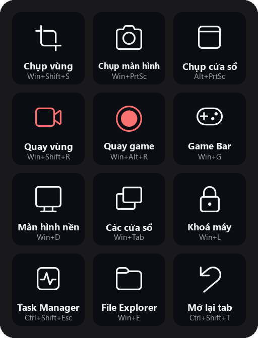
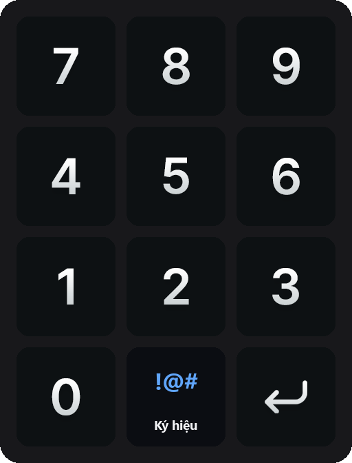
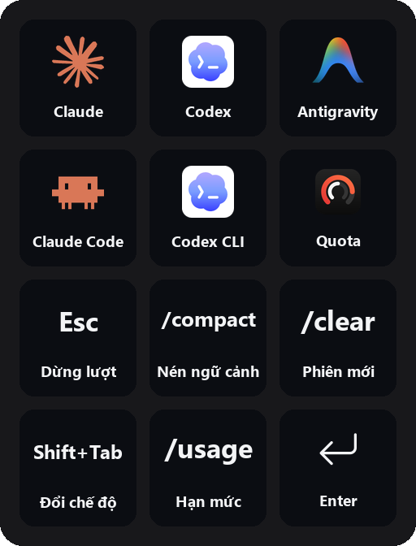
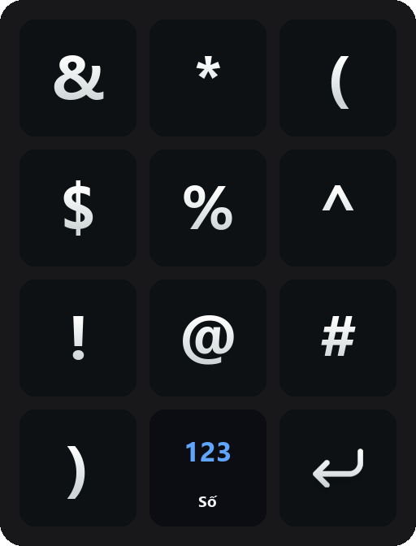
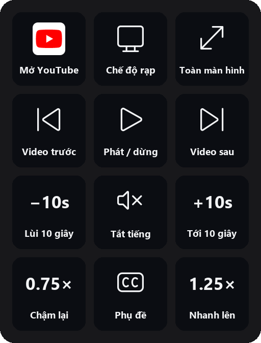

# Galleon Customizer

App and settings for the Corsair Galleon 100 SD Stream Deck keys, screen and dials on Linux.

`app/` holds the app: a fork of [GalleonCore](https://github.com/Paullux/GalleonCore) v0.3.0
by Paul Woisard, renamed and extended (see `app/README.md`). It has two programs:
`galleon-customizerd` (the daemon that drives the module) and `galleon-customizer`
(the settings window, in the notification area).

## Pages

The pages, key pictures and actions of the "Minh Spark" Stream Deck profile from
Windows (`data/icons/streamdeck/custom/profiles/minh-spark`), with Windows-only
actions replaced by their Ubuntu equivalents:

| Page | Keys |
|---|---|
| Chụp & Phím tắt (home) | area/full/window screenshot, record area (GNOME recorder) / full screen, OBS (was Game Bar), Super+D, overview (was Win+Tab), lock, Resources (was Task Manager), Files, Ctrl+Shift+T |
| Phím số | numeric keypad; the middle bottom key opens Ký hiệu |
| Claude & Codex | Claude app, Codex (web), Claude Code / Codex CLI in a terminal, Esc, Shift+Tab, Enter, types `/compact`, `/clear`, `/usage` |
| Ký hiệu | `& * ( $ % ^ ! @ # )`, Enter; the middle bottom key goes back to Phím số |
| YouTube | open YouTube, theater, full screen, previous/play/next, -10 s, mute, +10 s, slower, captions, faster |

### Key pictures

Every page as it shows on the module (keys left to right, top to bottom).
The pictures are in `config/icons/`; these previews are made from them with `config/pages.json`.

<table>
<tr><th>Chụp &amp; Phím tắt (home)</th><th>Phím số</th><th>Claude &amp; Codex</th><th>Ký hiệu</th><th>YouTube</th></tr>
<tr><td></td><td></td><td></td><td></td><td></td></tr>
</table>

Antigravity and Quota keys show their pictures but do nothing (no Linux app).
The "Phiên AI" page and the AI Quota touch strip need the Windows plugin and are not ported.

Dials:
- Left: turn = next/previous page, press = back to "Chụp & Phím tắt".
- Right: turn = volume (3 % per step), press = mute.

## Files

- `app/` — the app source (C++/Qt 6, CMake). GPL-3.0-or-later.
- `config/pages.json` — keys and dials (`@HOME@` is replaced at install).
- `config/icons/*.png` — key pictures, installed next to `pages.json`.
- `bin/galleon-shot` — screenshots via flameshot (`full`, `area`, `delay`).
- `bin/galleon-screenrec` — toggle recording via the screen-cast portal + GStreamer (NVENC, x264 fallback).
- `applications/*.desktop` — launchers the keys start (app keys can only start `.desktop` files).
- `systemd/galleon-customizerd.service` — user service for `/usr/local/bin/galleon-customizerd`.
- `autostart/galleon-customizer.desktop` — starts the settings window at login, hidden in the notification area (`--minimized`; needs the AppIndicator extension on GNOME).
- `udev/70-galleon.rules` — lets the logged-in user open the keyboard.
- `data/icons/streamdeck/` — icons and profiles copied from the Stream Deck app on Windows.

Settings live in `~/.config/galleon-customizer/` (moved once from `~/.config/galleoncore/` by `install.sh`).

## Use

```sh
./install.sh --app      # build, test and install the app (sudo), then the settings
./install.sh            # settings only: ~/.config, ~/.local, user service
./install.sh --system   # also install the udev rule (sudo)
./save.sh               # copy live settings back here after editing keys in the app
```

## License

GPL-3.0-or-later (see `LICENSE`), as the app is a fork of GalleonCore. The wallpapers and
screensavers in `app/public/` are CC-BY-SA-4.0 (see `app/REUSE.toml`). The Stream Deck
icons in `data/icons/streamdeck/` keep their own licenses (see its README).
